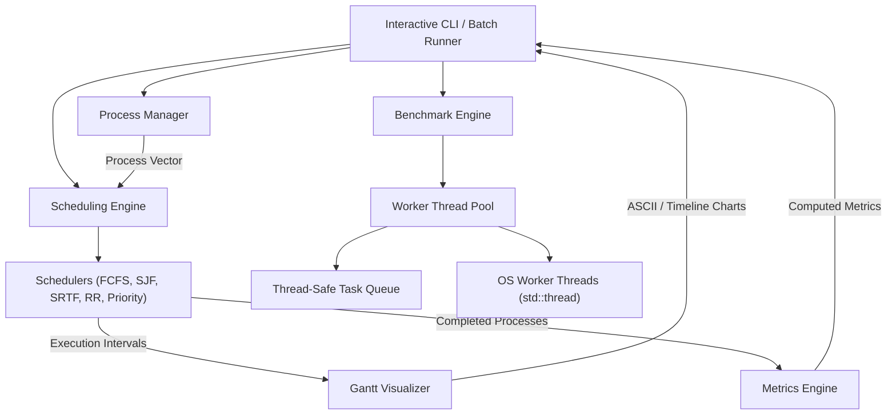

# SchedOS — CPU Scheduling and Process Management Simulator

[](https://en.cppreference.com/w/cpp/17)
[](https://cmake.org/)
[](LICENSE)
[](#testing-and-verification)

**SchedOS** is a modular operating system CPU scheduling simulator and multicore benchmarking framework written in modern C++17. It models uniprocessor CPU scheduling dynamics, preemptive context switching, idle intervals, and scheduling performance metrics with zero external dependencies.

In addition to discrete-event scheduling simulation, SchedOS includes a native multithreading module featuring a thread-safe task queue and a reusable worker thread pool to benchmark multicore speedup and throughput on real CPU-bound workloads.

---

## Problem Statement

Operating system kernels must arbitrate access to physical processor cores among competing processes while balancing throughput, latency, responsiveness, and fairness. Understanding and optimizing CPU scheduling requires analyzing key trade-offs:
- Preemptive vs. non-preemptive dispatching
- Context-switch overhead and scheduling latency
- Starvation hazards in priority systems
- Multicore scaling limits governed by Amdahl's Law

SchedOS models these dynamics through deterministic simulation while providing a native multithreading framework to measure real host concurrency.

---

## Technology Stack

SchedOS is implemented in standard C++17 with **zero external dependencies**:

- **Language Standard**: C++17 (`std::unique_ptr`, `std::optional`, `std::string_view`, structured bindings, `std::tuple`)
- **Standard Template Library (STL)**: `<vector>`, `<queue>`, `<memory>`, `<algorithm>`, `<numeric>`, `<chrono>`
- **Concurrency & Synchronization**: `<thread>`, `<mutex>`, `<condition_variable>`, `<atomic>`, `<future>`
- **Build System**: CMake 3.14+ (Cross-platform, strict warning flags `-Wall -Wextra -Wpedantic` / `/W4`, static linking)
- **Testing**: Lightweight native C++ assertion test suite and CTest integration (269 automated assertions)

---

## Architectural Design

SchedOS strictly decouples deterministic scheduling simulation from actual host multithreaded task execution.



### Module Responsibilities

1. **Interactive CLI (`CLI.h`, `CLI.cpp`)**: Menu-driven console interface, input validation, ANSI formatting, and batch argument parsing.
2. **Process Manager (`ProcessManager.h`, `ProcessManager.cpp`)**: In-memory repository supporting CRUD operations, duplicate PID detection, and integrity checks.
3. **Scheduling Engine (`Scheduler.h`, `*Scheduler.cpp`)**: Polymorphic scheduling implementations modeling uniprocessor execution timelines.
4. **Metrics Engine (`Metrics.h`, `Metrics.cpp`)**: Computes turnaround, waiting, response times, productive CPU utilization, total occupancy, throughput, and fairness dispersion.
5. **Gantt Visualizer (`GanttChart.h`, `GanttChart.cpp`)**: Generates aligned ASCII execution bar charts, arrow timelines, and preemption logs.
6. **Task Queue (`TaskQueue.h`, `TaskQueue.cpp`)**: Thread-safe FIFO queue guarded by `std::mutex` and `std::condition_variable`.
7. **Thread Pool (`ThreadPool.h`, `ThreadPool.cpp`)**: Reusable RAII worker pool managing host `std::thread` instances with `std::future` task returns.
8. **Benchmark Engine (`BenchmarkEngine.h`, `BenchmarkEngine.cpp`)**: Measures sequential vs. parallel speedup on CPU-bound workloads.

---

## Core Features

### 1. CPU Scheduling Engine
- **5 Scheduling Algorithms**: FCFS, SJF (non-preemptive), SRTF (preemptive), Round Robin (configurable quantum), and Priority Scheduling.
- **Dynamic Priority Aging**: Prevents process starvation by boosting waiting task priorities over configurable time intervals ($P_{\text{eff}} = \max(0, P_{\text{base}} - \lfloor \frac{\text{Wait}}{\text{Interval}} \rfloor)$).
- **Realistic Context Switching**: Configurable switch cost ($C$). Accurately accounts for CPU time lost during process switches, models process arrivals during context switches, and charges switches only for inter-process transitions.

### 2. Process Management
- **Interactive In-Memory Store**: Add, view, edit, delete, and query processes by PID.
- **Input Validation**: Rejects negative arrival times, non-positive burst times, negative priorities, and duplicate PIDs.
- **CSV Import & Export**: Automated schema validation, error detection, and benchmark result persistence.

### 3. Scheduling Visualization
- **Terminal Gantt Bar Charts**: Fixed-width aligned ASCII bar representations with accurate time markers.
- **Arrow Execution Timelines**: Formatted interval sequences (`P1 [0–3] -> CS [3–4] -> P2 [4–8]`).
- **Auto-Wrapping**: Wraps extensive timelines cleanly without corrupting terminal line buffers.

### 4. Performance & Fairness Analysis
- **Standard Process Metrics**: Completion Time ($CT$), Turnaround Time ($TAT$), Waiting Time ($WT$), Response Time ($RT$).
- **CPU Metrics**: Productive CPU Utilization ($\frac{\text{Busy}}{\text{Total}}$) vs. Total CPU Occupancy ($\frac{\text{Busy} + \text{CS Overhead}}{\text{Total}}$).
- **Fairness Dispersion**: Computes Waiting-Time Variance ($\sigma^2$) and Standard Deviation ($\sigma$) to measure scheduling equity.
- **Comparison Engine**: Benchmarks all 5 algorithms on identical datasets, identifies best-performing algorithms per metric, and articulates OS trade-offs.

### 5. Multithreading & Concurrency
- **Thread-Safe Queue**: Condition variable wakeups, non-blocking polling (`tryPop`), blocking waits (`pop`), and thread-safe shutdown.
- **Worker Thread Pool**: Configurable worker count, lock-free task tracking via `std::atomic<size_t>`, exception propagation across threads, and clean RAII teardown.
- **Simulation vs. Host Execution Separation**: Clear boundaries between mathematical scheduling models and host OS worker threads.

### 6. Testing & Benchmarking
- **Comprehensive Harness**: 269 automated assertions across 19 suites.
- **Independent Verification**: Hand-calculated test cases verifying boundary conditions, preemption, idle gaps, and priority aging.
- **Scale Stress Testing**: Validated on batches of 100, 1,000, and 10,000 processes without memory leaks or performance degradation.

---

## Implemented Scheduling Algorithms

| Algorithm | Preemption | Data Structure | Time Complexity | Strengths | Limitations |
|:---|:---:|:---:|:---:|:---|:---|
| **First-Come, First-Served (FCFS)** | No | Sorted `std::vector` | $O(N \log N)$ sort, $O(N)$ execution | Minimal overhead, zero preemption, starvation-free | Susceptible to Convoy Effect; high average turnaround time |
| **Shortest Job First (SJF)** | No | Ready scan array | $O(N^2)$ scan / $O(N \log N)$ priority queue | Mathematically optimal minimum average waiting time | Starvation for long bursts; requires advance knowledge of burst time |
| **Shortest Remaining Time First (SRTF)** | **Yes** | Dynamic remaining burst tracking | $O(T \cdot N)$ discrete timeline | Minimizes turnaround and response times for interactive jobs | Frequent context switches increase overhead; potential starvation |
| **Round Robin (RR)** | **Yes** | `std::queue<int>` (FIFO Ready Queue) | $O(\sum \lceil \frac{BT_i}{q} \rceil)$ decisions | Fair CPU allocation, responsive, starvation-free | Degenerates to FCFS if $q$ is large; high overhead if $q$ is too small |
| **Priority Scheduling (with Aging)** | No | Dynamic priority scan vector | $O(N^2)$ candidate evaluations | Reflects task urgency and criticality; aging prevents starvation | Without aging, low-priority tasks starve indefinitely |

---

## Concurrency Performance Benchmarking

The `BenchmarkEngine` executes compute-heavy workloads across multiple worker threads to evaluate multicore scalability.

### Methodology
- **CPU-Bound Workload**: Pseudo-random integer transformations, bitwise operations, and cryptographic mixing.
- **Dead-Code Elimination Defense**: Volatile accumulators guarantee compilers cannot optimize away work loops.
- **Monotonic High-Precision Timing**: Clocked with `std::chrono::steady_clock`.
- **Warm-Up & Median Filtering**: Warms instruction/data caches, repeats measurements across configurable iterations, and reports the median.
- **Result Integrity Validation**: Asserts that sequential checksums match multithreaded checksums ($\text{Checksum}_{\text{seq}} == \text{Checksum}_{\text{par}}$).

### Measured Performance Results (Host Machine)
- **Environment**: AMD/Intel 16 logical hardware threads, MinGW GCC 13.2.0, Windows 11.

```
======================================================================
            CONCURRENCY & MULTITHREADING PERFORMANCE BENCHMARK        
======================================================================
  Workload Configuration:
    Total CPU-Bound Tasks     : 100
    Iterations Per Task       : 25000
    Worker Thread Count       : 16
    Benchmark Repetitions     : 3 (Median reported)

  Execution Timing Results:
    Sequential Execution Time : 5.53 ms
    Multithreaded Time        : 0.88 ms
    Speedup Ratio             : 6.27x

  Throughput Analysis:
    Sequential Throughput     : 18070.44 tasks/sec
    Multithreaded Throughput  : 113314.45 tasks/sec

  Result Validation:
    Sequential Checksum       : 0x35dd8c026717d271
    Parallel Checksum         : 0x35dd8c026717d271
    Equivalence Check         : PASS (Identical Results)
======================================================================
```

### Amdahl's Law & Concurrency Analysis
- **Theoretical Bound**: Speedup is bounded by $\frac{1}{(1 - P) + \frac{P}{N}}$, where $P$ is the parallel fraction and $N$ is thread count.
- **Synchronization Overhead**: TaskQueue mutex lock/unlock and thread wakeups introduce small constant overheads.
- **Hardware Dependence**: Results vary depending on CPU physical core count, thermal throttling, cache hierarchies, and memory bus saturation.

---

## Terminal Screenshots & Execution Previews

Captured terminal sessions are cataloged in [`docs/screenshots/`](docs/screenshots/README.md):

1. **[Interactive Main Menu](docs/screenshots/01_main_menu.txt)**: Full 12-option terminal interface.
2. **[Process Table Management](docs/screenshots/02_process_management.txt)**: Tabular process displays with PID and arrival information.
3. **[Gantt Chart Visualization](docs/screenshots/03_gantt_chart.txt)**: ASCII Gantt bar charts, arrow execution timelines, and preemption logs.
4. **[Algorithm Comparison Benchmark](docs/screenshots/04_algorithm_comparison.txt)**: Side-by-side performance comparisons and trade-off analysis.
5. **[Multithreading Performance Benchmark](docs/screenshots/05_multithreading_benchmark.txt)**: High-resolution parallel speedup and throughput metrics.

---

## Installation & Build Instructions

### Prerequisites
- C++17 compliant compiler (`g++` 8+, `clang++` 7+, MSVC 2019+)
- CMake 3.14+

### Clone & Build

```bash
# 1. Clone repository
git clone https://github.com/Snehalgupta-07/SchedOS.git
cd SchedOS

# 2. Configure build
mkdir build
cd build
cmake ..

# 3. Compile project
cmake --build .
```

On Windows with MinGW Makefiles:
```powershell
mkdir build
cd build
cmake -G "MinGW Makefiles" ..
mingw32-make
```

### Execution Commands

```bash
# Launch interactive terminal CLI
./schedos

# Run headless concurrency benchmark
./schedos -b

# Batch execution on CSV comparing all 5 algorithms
./schedos -f ../samples/processes.csv -a all -q 2 -c 1

# Specific algorithm with Round Robin quantum 3 and context-switch cost 1
./schedos -f ../samples/processes.csv -a rr -q 3 -c 1
```

---

## Testing and Verification

### Automated Test Suite

Run the built test binary or use CTest:

```bash
# Direct test execution
./schedos_tests

# CTest execution with failure tracing
ctest --output-on-failure
```

### Test Coverage Summary (269 Passed Assertions)

```
========================================
   SchedOS — Scheduling Test Suite     
========================================

--- FCFS Tests ---
--- SJF Tests ---
--- SRTF Tests ---
--- Round Robin Tests ---
--- Priority Scheduling Tests ---
--- Metrics Tests ---
--- Edge Case Tests ---
--- ProcessManager Tests ---
--- GanttChart Tests ---
--- Context Switching Tests ---
--- ComparisonEngine Tests ---
--- CSVManager Tests ---
--- Advanced Verification Tests ---
--- TaskQueue Tests ---
--- ThreadPool Tests ---
--- BenchmarkEngine Tests ---
--- Fairness & Aging Tests ---
--- Stress & Concurrency Scale Tests ---
--- Independent Algorithm Verification Tests ---

========================================
  Results: 269 passed, 0 failed, 269 total
========================================
```

### Compiler Sanitizers Status
- **AddressSanitizer / UndefinedBehaviorSanitizer / ThreadSanitizer**: On Windows MinGW-w64 distributions, sanitizer runtimes (`libasan`, `libubsan`, `libtsan`) are typically not packaged by default. The codebase adheres strictly to C++17 RAII memory safety and compiles cleanly under `-Wall -Wextra -Wpedantic` with zero warnings. On Linux/macOS environments, sanitizers can be enabled via `-fsanitize=address,undefined`.

---

## Architectural Limitations

1. **Deterministic Simulation Scope**: The CPU scheduling algorithms (FCFS, SJF, SRTF, RR, Priority) are discrete mathematical simulations designed for uniprocessor educational analysis. They do not replace or modify the host operating system's kernel scheduler.
2. **Separation of Concerns**: Simulated processes do not map directly to host OS threads; the `ThreadPool` executes actual native tasks independently for concurrency benchmarking.
3. **Hardware Dependence**: Benchmarked speedup and throughput depend directly on host core count, CPU architecture, memory bandwidth, and background OS activity. Multithreading will not always show linear speedup for trivial workloads due to thread management overhead.
